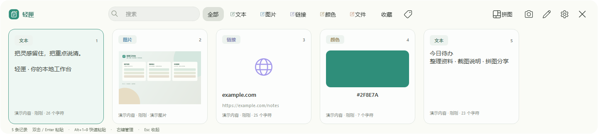
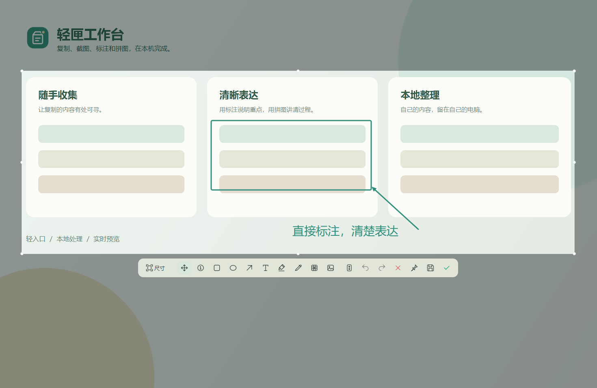
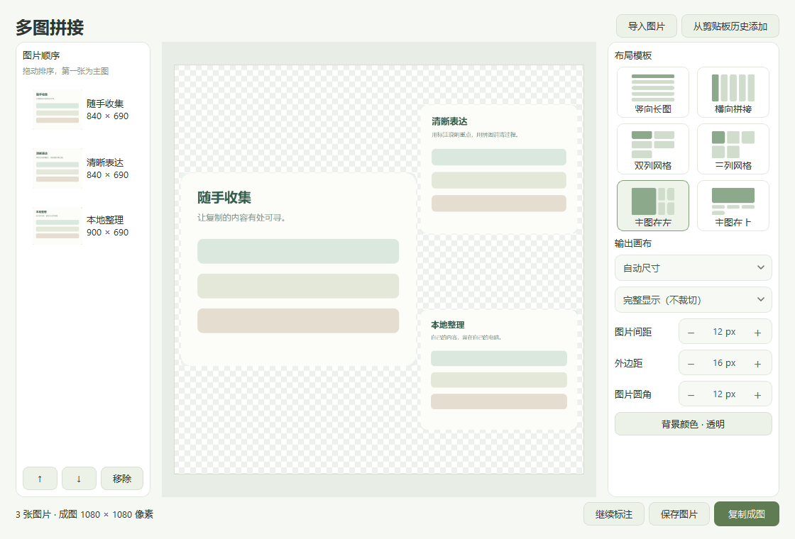

# 轻匣 QingXia

Windows 本地剪贴板与截图工具。收集随手复制的内容，用截图标注表达重点，用多图布局整理图片。



## 功能

- **剪贴板历史**：文字、图片、文件、链接与颜色，支持搜索、收藏、标签和快捷粘贴。
- **截图与标注**：直接输入文字，可移动标注，提供箭头、形状、高亮、马赛克和钉图。
- **滚动长截图**：边滚动边拼接，右侧实时预览；已捕获的动态区域保留当时的静帧。
- **多图拼接**：六种布局、透明背景、间距与圆角，支持复制、保存和继续标注。
- **统一设置**：自定义全局快捷键、开机自启动、记录开关与本地数据管理。

| 截图标注 | 多图拼接 |
| --- | --- |
|  |  |

## 使用

Windows 10 / 11，64 位。便携版在仓库的 **Releases** 下载，解压后运行 `QingXia.exe`。请完整保留解压后的文件夹；程序会驻留系统托盘，可从托盘退出。

| 默认快捷键 | 功能 |
| --- | --- |
| Ctrl+Alt+V | 显示 / 隐藏剪贴板 |
| Ctrl+Alt+S | 截图 |
| Ctrl+Alt+E | 打开图片标注 |

快捷键可在设置中修改。升级时先从托盘退出旧版本，再解压新版至固定目录；移动目录后重新开启自启动以更新路径。

历史与设置保存在 `%LOCALAPPDATA%\QingXia\data`，升级程序时保留。数据未加密，请勿复制不希望留在历史中的敏感内容，可暂停记录或在设置中清理未收藏记录。文件历史仅保存原路径。当前不含 OCR、录屏或云同步。

详细操作见 [使用说明](docs/usage.md)，[查看快捷键设置截图](docs/screenshots/settings.png)。

## 从源码运行

安装 Windows 64 位 Python 3.13，然后在仓库目录执行：

```powershell
python -m venv .venv
.\.venv\Scripts\python.exe -m pip install -r requirements.txt
.\.venv\Scripts\python.exe main.py
```

无需管理员权限。开发验证与 EXE 构建见 [贡献指南](CONTRIBUTING.md)。

## 版本更新

使用 `主版本.次版本.修订号` 编号，变更记录见 [CHANGELOG](CHANGELOG.md)。每次发布用对应 `vX.Y.Z` 标签关联源码和 Release 附件。早期版本仍在迭代，请通过 Issues 提交可复现的问题。

## 开源与素材

项目以 [GPL-3.0-only](LICENSE) 发布。第三方控件、图标及工具的许可见 [依赖声明](THIRD_PARTY_NOTICES.md)。品牌、标注 SVG 与演示画面由本项目制作；文档截图来自真实应用控件与自制演示内容，见 [截图说明](docs/screenshots/README.md)。
